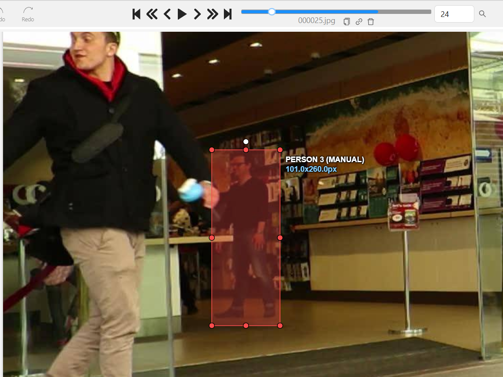
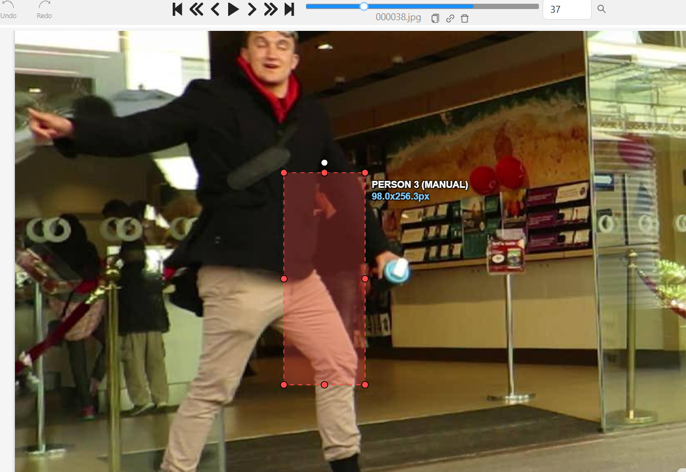
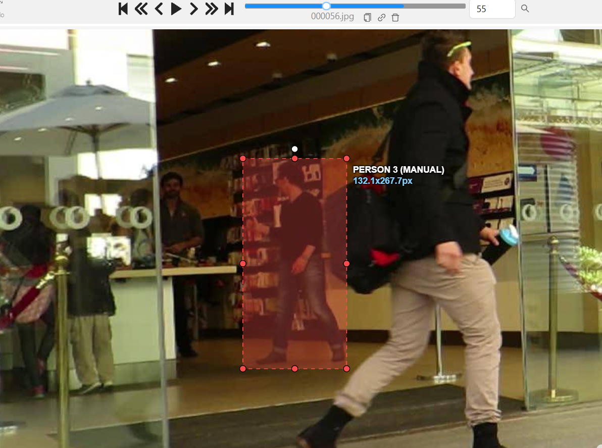

# Báo cáo cá nhân — HoVaTen-MSSV

Đổi tên file theo quy tắc `MSSV_HoTen.md`. Ví dụ: `20241234_NguyenVanAn.md`.

Đoạn video: MOT17-09, 150 frame (frame 1–150), nguồn MOTChallenge, giấy phép CC BY-NC-SA 3.0.

## 0. Thông tin học viên

- Họ tên: Hoàng Gia Bảo
- MSSV: 2A202603138
- Mã đề (A/B/C): A
- Email:baohoanggia9@gmail.com
- Link repository:https://github.com/GBao294/K5-L2-DAY05-HOANGGIABAO-202603138-MOTTracking
- Giờ bắt đầu:17h 13/11
- Giờ kết thúc: 2h 14/11

## 1. Xem trước đoạn video (CP0)

### Quy ước ánh xạ ID

| Mã người | ID trong báo cáo | CVAT Track |
|---|---:|---:|
| P1 | 3 | 2 |
| P2 | 4 | 3 |
| P3 | 1 | 0 |
| P4 | 2 | 1 |
| P5 | 5 | 4 |

Ghi **trước khi vẽ**, mỗi người một dòng.

| Mã | Frame xuất hiện | Frame cuối thấy được | Rẽ / dừng / đổi tốc độ | Bị che (số frame) | Ghi chú |
|---|---:|---:|---|---:|---|
| P1 (ID 3) | 0 | 149 | Theo dõi định kỳ mỗi 7 frame; bổ sung keyframe tại các thời điểm chuyển động thay đổi | 31 | Theo dõi xuyên suốt video |
| P2 (ID 4) | 63 | 149 | Theo dõi định kỳ mỗi 7 frame; bổ sung keyframe tại các thời điểm chuyển động thay đổi | 28 | Xuất hiện từ frame 63 |
| P3 (ID 1) | 0 | 149 | Theo dõi định kỳ mỗi 7 frame; bổ sung keyframe tại các thời điểm chuyển động thay đổi | 0 | Theo dõi xuyên suốt video |
| P4 (ID 2) | 0 | 149 | Theo dõi định kỳ mỗi 7 frame; bổ sung keyframe tại các thời điểm chuyển động thay đổi | 67 | Có hiện tượng che khuất nhiều |
| P5 (ID 5) | 0 | 140 | Theo dõi định kỳ; bổ sung keyframe khi cần nối lại track | 14 | Có đoạn outside; xuất hiện lại gần cuối video |

## 2. Keyframe và thời gian (CP1, CP4)

Số liệu dưới đây lấy từ **lần chạy kiểm tra cuối cùng** của `src/check_submission.py`, phần CVAT for video 1.1. Số frame tính theo CVAT, bắt đầu từ 0.

| Mã | Số keyframe | Keyframe ở frame | Số frame có mặt | Keyframe / 100 frame | Thời gian (phút) | Chỗ khó |
|---|---:|---|---:|---:|---:|---|
| P1 (ID 3) | 25 | 0, 7, 14, 21, 24, 25, 28, 35, 49, 56, 63, 70, 77, 84, 91, 98, 105, 112, 119, 126, 133, 140, 147, 148, 149 | 150 | 16.7 | 30 | Theo dõi chuyển động và duy trì ID ổn định |
| P2 (ID 4) | 15 | 63, 70, 77, 84, 91, 98, 105, 112, 119, 126, 133, 140, 147, 148, 149 | 87 | 17.2 | 30 | Theo dõi từ thời điểm xuất hiện |
| P3 (ID 1) | 23 | 0, 14, 21, 28, 35, 42, 49, 56, 63, 70, 77, 84, 91, 98, 105, 112, 119, 126, 133, 140, 147, 148, 149 | 150 | 15.3 | 30 | Duy trì bounding box ổn định |
| P4 (ID 2) | 25 | 0, 7, 14, 21, 25, 28, 35, 42, 49, 56, 63, 70, 77, 84, 91, 98, 105, 112, 119, 126, 133, 140, 147, 148, 149 | 150 | 16.7 | 30 | Có nhiều frame bị che khuất |
| P5 (ID 5) | 13 | 0, 14, 28, 42, 56, 63, 70, 84, 98, 105, 137, 139, 140 | 120 | 10.8 | 15 | Xử lý đoạn outside và nối lại ID |

**Tổng:** 101 keyframe / 657 frame có mặt = **15.4 keyframe / 100 frame**.


**Bạn đặt keyframe nhiều nhất ở người nào? Vì sao?**

P1 (ID 3) và P4 (ID 2) cùng có số keyframe cao nhất, mỗi người 25 keyframe. Với P4, nguyên nhân chính là người này thường xuyên bị che khuất (67 frame theo kết quả kiểm tra), đồng thời di chuyển gần người khác nên bounding box khó được nội suy chính xác. Với P1, các keyframe bổ sung tại frame 24 và 25 giúp mô tả những thay đổi cục bộ trong quá trình theo dõi. Vì vậy, em sử dụng khoảng cách keyframe định kỳ khoảng 7 frame và bổ sung keyframe tại những vị trí cần thiết thay vì chỉ dựa vào một khoảng cách cố định.

...

## 3. Đoạn bị che (CP2)

**Người được chọn:** P1 (ID 3, CVAT Track 2).

| Mốc | Frame |
|---|---:|
| Bắt đầu bị che một phần (bật `occluded`) | 26 |
| Mất hẳn (bật `outside`) | Không có vẫn thấy 1 phần|
| Hiện lại (tắt `outside`) | Không có vẫn thấy 1 phần |
| Thấy rõ trở lại (tắt `occluded`) | Từ frame 25 đến 55 |

- **Tổng số frame occluded theo checker:** 31 frame.
- **Thời gian khuất hẳn:** Chưa xác định được khoảng outside riêng của P1; không suy ra từ tổng số frame occluded.
- **Quyết định:** Giữ cùng ID.
- **Lý do:** Em giữ cùng ID vì đây là tình huống che khuất trong quá trình theo dõi, không có đủ bằng chứng cho thấy người đó rời khỏi cảnh và một người khác xuất hiện thay thế. Khi người đó xuất hiện lại, cần đối chiếu vị trí, hướng di chuyển, tốc độ và đặc điểm ngoại hình với các frame trước khi che. Tổng thời gian occluded là 31 frame, thấp hơn mốc 60 frame; do đó việc duy trì ID là hợp lý nếu các dấu hiệu nhận dạng và quỹ đạo vẫn nhất quán.

Ảnh chụp màn hình:





## 4. Tự review ID (CP3)

Lượt 1: rà theo từng người, đi ngược từ frame 149 về frame 0 trên CVAT.  
Lượt 2: rà theo toàn cảnh, nhảy mỗi 10 frame.

| Frame | Mã người | Loại lỗi | Mô tả một câu | Phát hiện ở lượt | Đã sửa? |
|---:|---|---|---|---|---|
| — | — | — | Đã kiểm tra hai lượt; checker cuối cùng không ghi nhận lỗi hoặc cảnh báo. | Lượt 1 và 2 | Không phát hiện lỗi |

**Tổng hợp số lỗi theo loại:**

| `id_switch` | `fragmentation` | `lost` | `merge` | `false_track` | `drift` | `flag` |
|---:|---:|---:|---:|---:|---:|---:|
| 0 | 0 | 0 | 0 | 0 | 0 | 0 |

**Lỗi nào chỉ lượt 2 (theo cảnh) mới thấy, lượt 1 (theo người) không thấy? Vì sao?**

Không ghi nhận lỗi ID còn sót sau hai lượt review. Lượt rà theo cảnh giúp kiểm tra đồng thời quan hệ giữa các người trong cùng frame, đặc biệt là những thời điểm hai người đi sát hoặc che khuất nhau. Đây là bước bổ sung cho lượt rà theo từng người, vốn tập trung nhiều hơn vào tính liên tục của từng track.


## 5. File xuất và kết quả tự kiểm (CP4)
| Kiểm tra | Kết quả |
|---|---|
| Tên file MOT 1.1 | `HoangGiaBao_mot.zip` |
| Tên file CVAT for video 1.1 | `HoangGiaBao_cvat_video.zip` |
| Số track ID khác nhau trong `gt/gt.txt` | 5 — đạt yêu cầu |
| Frame `outside` không có dòng trong `gt.txt` | Checker xác nhận tổng số box và các đoạn outside; cần đối chiếu trực tiếp nếu cần xác nhận riêng từng frame |
| Job đã completed trên CVAT máy cá nhân | Chưa có thông tin xác nhận trong log |
Dán phần tóm tắt in ra từ `src/check_submission.py`:

```text
Số frame in theo CVAT (bắt đầu từ 0). Trong gt.txt, frame_id = frame CVAT + 1.

=== File MOT 1.1: HoangGiaBao_mot.zip ===
Số track ID: 5 | Tổng số box: 657
[OK] Đúng 5 track ID.

Track | Frame có mặt | Số frame | Đoạn vắng (outside)
1     | 0–149        | 150      | -
2     | 0–149        | 150      | -
3     | 0–149        | 150      | -
4     | 0–146        | 120      | 110–136
5     | 63–149       | 87       | -

=== File CVAT for video 1.1: HoangGiaBao_cvat_video.zip ===

Track | Nhãn   | Frame thấy | Keyframe | KF/100 frame | Frame occluded | Lần bật outside
0     | person | 150        | 23       | 15.3        | 0              | 0
1     | person | 150        | 25       | 16.7        | 67             | 0
2     | person | 150        | 25       | 16.7        | 31             | 0
3     | person | 87         | 15       | 17.2        | 28             | 0
4     | person | 120        | 13       | 10.8        | 14             | 2

Tổng: 101 keyframe / 657 frame có mặt = 15.4 keyframe / 100 frame
[OK] Đọc được 5 track từ annotations.xml.

=== Tóm tắt ===
Lỗi: 0 | Cảnh báo: 0
Đạt.
```

## 6. Ba câu kết

**1. Nếu được gán lại, bạn sẽ đặt keyframe khác ở đâu? Vì sao?**

Nếu được gán lại, em sẽ bổ sung keyframe ở những đoạn người đi sát nhau, bị che khuất hoặc thay đổi hướng di chuyển đột ngột. Đặc biệt, em sẽ kiểm tra kỹ các frame ngay trước và sau khi bật/tắt `occluded` hoặc `outside` để bounding box không bị trôi và ID được nối liên tục.

**2. Có chỗ nào bạn không chắc "cùng ID hay ID mới"? Bạn đã quyết định và ghi chú thế nào?**

Có những thời điểm người bị che khuất một phần khiến việc xác định danh tính khó hơn. Em ưu tiên giữ ID cũ nếu vị trí xuất hiện lại, hướng di chuyển, tốc độ và đặc điểm ngoại hình phù hợp với quỹ đạo trước đó. Chỉ tạo ID mới khi có đủ bằng chứng đó là một đối tượng khác; các thời điểm cần chú ý được kiểm tra lại ở lượt review theo cảnh.

**3. Một lỗi ID trong job của bạn có thể làm xe tự lái dự đoán sai chuyển động của người đó như thế nào? Lỗi đó ảnh hưởng MOTA hay IDF1 nhiều hơn?**

Nếu một người bị gán nhầm ID, hệ thống có thể hiểu một người đang di chuyển liên tục thành hai đối tượng khác nhau, hoặc ghép chuyển động của hai người thành một track. Khi đó, mô hình dự đoán quỹ đạo có thể ước lượng sai hướng và vận tốc, dẫn đến dự đoán sai vị trí người đi bộ trong các frame tiếp theo. Lỗi hoán đổi hoặc phân mảnh ID thường ảnh hưởng IDF1 rõ hơn vì IDF1 đánh giá tính nhất quán của danh tính qua nhiều frame; MOTA cũng có thể bị ảnh hưởng nếu lỗi làm phát sinh các trường hợp false positive, false negative hoặc ID switch.

## Bonus (nếu làm)

### B1 — Hai người đi sát

...

### B2 — So cách đặt keyframe

| Cách đặt | Số keyframe | Frame trôi nhất | Ghi chú |
|---|---:|---:|---|
| Đều mỗi 30 frame | | | |
| Theo chỗ đổi hướng | | | |

...

### B3 — So với tracker có sẵn

| Frame | Mã người | Tracker làm gì | Nhãn của bạn | Giải thích (đoán rồi sửa / ghép IoU / box score thấp / ngoại hình) |
|---:|---|---|---|---|
| | | | | |
| | | | | |

## 7. Tài liệu tham khảo và công cụ AI đã dùng

...
